<p align="center">
  
</p>

<p align="center">
  <a href="https://salehrafi.vercel.app"></a>
  <a href="https://www.linkedin.com/in/salehrafi/"></a>
  <a href="https://codeforces.com/profile/wizz_rafi"></a>
  <a href="https://www.kaggle.com/salehrafi"></a>
</p>

### `$ whoami`

```python
rafi = {
    "role":      "Software Engineer",
    "location":  "Dhaka, Bangladesh",
    "education": "B.Sc. in Computer Science & Engineering, East West University (2022 - 2026)",
    "focus":     ["Backend & Full-Stack", "Machine Learning", "Computer Vision"],
    "research":  "Reliable AI for chest X-ray screening (CNN-GATv2 fusion + conformal prediction)",
    "status":    "Open to Software Engineer roles",
}
```

I build web apps and ML systems with Python, FastAPI/Flask, SQL and JavaScript, and I care about software that is reliable enough to trust in production.

### `$ ls ~/projects`

| Project | What it does | Stack |
|---|---|---|
| [Tune Snap](https://github.com/salehrafi/Tune-Snap) | Chrome extension that identifies songs in Instagram Reels and finds them on YouTube | TypeScript, React, WXT, YouTube Data API |
| FLIR Thermal Object Detection | YOLO pipeline with self-supervised pretraining for low-contrast thermal imagery | Python, YOLO, Computer Vision |
| [Community Lens](https://github.com/salehrafi/Community-Lens) | Chrome extension for credibility, risk and sentiment analysis of YouTube comments | JavaScript, OpenAI API |
| [Provenance-Enabled RDBMS](https://github.com/salehrafi/Provenance-Enabled-RDBMS) | E-commerce database that tracks data lineage and audit history with triggers | PL/SQL, Python, Flask |
| [Quiz App](https://github.com/salehrafi/Quiz-App) | Full-stack quiz platform with role-based auth, live scoring and result emails | PHP, MySQL, JavaScript |
| [Portfolio](https://salehrafi.vercel.app) | Portfolio and bilingual blog with an admin dashboard, RBAC and server-rendered SEO | React, Supabase, Vercel |

### `$ cat research.md`

**Undergraduate capstone** (Sept 2025 - Aug 2026), supervised by Prof. Dr. Ahmed Wasif Reza:
*Adaptive CNN-GATv2 Fusion with Uncertainty-Aware Conformal Prediction for Reliable Chest X-ray Screening and Diagnosis.*

- Curated a primary dataset of 500+ chest X-rays and reports from multiple hospitals
- Built a fused CNN-GNN model and used conformal prediction to quantify uncertainty for safer clinical decisions

### `$ cat achievements.log`

- **Champion**, Data War, National Telco Warfare 2024 (1st of 17 teams)
- **4th place**, Robosoccer Contest, EWU CSE Fest 2024
- **500+ problems** solved on Codeforces and other online judges
- National hackathons: Programming Hero (2024), BNNRC (2026)
- Board of Trustees Scholarship and Merit-Based Scholarship

### `$ tech --stack`

<p>
  <br />
  <br />
  
</p>

**Also:** Oracle SQL, PL/SQL, Pandas, NumPy, Matplotlib, Deep Learning, RAG, LangChain, LLM fine-tuning, Jupyter

### `$ ./terminal`

Explore my profile from a Linux-style terminal in your browser: type `help` to start.

<a href="https://salehrafi.github.io/salehrafi/terminal/">
  
</a>

### `$ git log --stats`

<p align="center">
  
</p>

<picture>
  <source media="(prefers-color-scheme: dark)" srcset="https://raw.githubusercontent.com/salehrafi/salehrafi/output/snake-dark.svg">
  
</picture>
